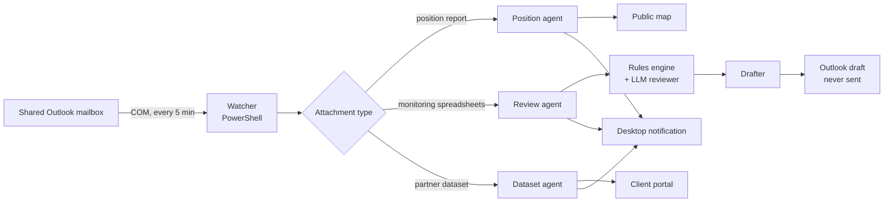

# E-mail-Driven Review Agents (case study)

[Português](README.md) · **English**

A desktop automation layer that watches a shared Outlook mailbox, saves incoming reports and spreadsheets, and dispatches three agents: one publishes vessel positions to a public map, one reviews technical monitoring spreadsheets with a deterministic rules engine plus an LLM "second opinion", and one publishes partner datasets to a client portal. A drafter turns review findings into an Outlook draft; nothing is ever sent automatically.

Built during my work at Toveri, an environmental consultancy that monitors offshore operations. Documentation only: no source code, client names, data or infrastructure identifiers.

> This repository is documentation only. The source code, data and infrastructure belong to the employer and are not published here. See [What is intentionally omitted](#what-is-intentionally-omitted).

## Problem

An environmental consultancy that monitors offshore seismic surveys receives, at any hour, e-mails from vessels and partners: daily position reports, record spreadsheets from the marine fauna and passive acoustic monitoring teams, operation and effort logs, review-control sheets and partner datasets.

Each item has to be saved, checked and acted on. Reviewing a monitoring record is meticulous work: timestamps against the operations log, mitigation interruption calculations, source states, and consistency between the narrative text and the data, against written instructions and precedent set by senior reviewers. Doing this by hand meant the first hours of each day went to triage before any judgement was applied.

Goal: incoming material saved, checked and summarised without manual triage, with every outgoing message held as a draft until a human approves it.

## My role

Sole developer and the primary user: I review these spreadsheets as part of the environmental team, and I designed, built and operate the automation. I used AI-assisted development (Claude Code) throughout; design decisions, review and responsibility for results are mine.

## Architecture

### Watcher

- A PowerShell script run by Windows Task Scheduler every five minutes, hidden. It reads Outlook through COM and never modifies or moves e-mail.
- Deduplicates by Outlook `EntryID` (and by subject plus received time for position reports), keeping a bounded set of the last 3,000 seen items in a state file; it only processes mail received after it was first started.
- One run at a time: a run still alive after four minutes is treated as stuck and terminated; a recent one causes the new run to exit.
- If Outlook is closed (for example right after boot), it starts Outlook minimised and exits; the next run finds the mailbox synchronised.
- Saves matching attachments into per-message folders and dispatches agents as separate hidden processes, so a review that takes minutes never blocks the watcher.

### Agent runner

- One instance per agent type, enforced by a lock file with a 40-minute staleness limit.
- If new material arrives while the review agent is running, the runner records a "repeat when done" flag instead of starting a second instance (up to three passes).
- The position agent drains a file queue in name order, so reports are processed chronologically.
- Each agent prints a JSON result (`status`, title, message, link). The runner turns it into a Windows notification under its own registered app identity, with a click-through to the result; quiet outcomes (no change, ignored) produce no notification, and any exception produces an error notification.

### Position agent

The desktop predecessor of the cloud pipeline described in the maritime operations map case study: parse the report, apply deterministic checks (newer than published, regional bounding box, implied speed), ask Claude for a plausibility opinion, and publish the last reported position as a file on the map's App Service through the Kudu VFS API. Authentication uses a short-lived token from the signed-in Azure CLI, so no credential is stored in the code or on disk by the agent.

### Review agent and expert reviewer

The review agent finds saved messages from the last two days that contain a monitoring record spreadsheet and a review-control sheet, pairs them with the most recent operations log, hashes the inputs (SHA-256 over file names and bytes) to skip anything already reviewed, and runs the expert reviewer. It is read-only.

The expert reviewer has two layers:

1. **Rules engine (deterministic, about 4,100 lines of Python).** Reads the record spreadsheets (openpyxl; oletools for macro-enabled workbooks) and checks them against the operations log and the written instructions: timestamps, interruption calculations, source states, concurrency of events, and whether corrections requested in a previous review round were applied.
2. **LLM reviewer.** A per-record dossier (record data, rule findings, relevant log rows, instruction excerpts, approved precedents) goes to Claude with a system prompt describing the role and method of an experienced marine biologist reviewer. The model must confirm or discard each rule finding with a reason and a source, may add technical or biological observations, and classifies every item as **Error** (objective divergence from the log, the sheet itself or an explicit rule), **Human validation** (a grounded doubt, phrased as a question) or **Suggestion** (clarity only, never sent to the operator).

Implementation details:

- **Two access paths, one fallback.** An API key if configured; otherwise the locally signed-in Claude Code CLI in headless mode (`-p`, no tools, JSON schema for the output, run from an empty temporary directory, no session persistence). With neither, the reviewer runs on rules alone and says so.
- **Rules survive model failure.** Any exception in the LLM layer is recorded and the rule findings are still reported.
- **Output normalisation.** The model's JSON is normalised against small naming variations, and a record the model marks "approve" is escalated to "request revision" if it contains any Error item.
- **Originals are never opened.** Inputs are copied to a temporary directory before parsing.
- **Feedback loop.** When a senior reviewer disagrees with a finding, the disagreement is stored in a shared folder and the written criteria files are updated, so the next run applies the corrected practice.
- **Interfaces.** A local web app (Python `ThreadingHTTPServer` bound to `127.0.0.1`) with an HTML report and history, a command-line entry point, a Claude Code skill, and a PyInstaller installer for colleagues.

### Drafter

Turns a batch of review reports into the reply a human sends:

- asks the model to re-verify every point and keep it only if it is supported by the data, not redundant with something the human reviewer already wrote, not contradicted by an approved precedent, and not speculative ("when in doubt, discard and explain why");
- writes comments and statuses into a copy of the review-control sheet through Excel COM, keeping the original untouched;
- creates an Outlook draft with the attachments and a short body, and saves the per-item justifications next to the sheet.

The Outlook item is created and saved as a draft. There is no send call in the code; a person reads, edits and sends.

### Dataset agent

Loads a partner's monitoring spreadsheets into the client portal through the portal's own loader, after validation, and reports one of: published, no change, held (validation failed, nothing published), or error.

## Key engineering decisions

- **Deterministic rules first, LLM as second opinion, human approval last.** The rules are fast, explainable and testable; the model adds judgement the rules cannot encode and must justify every item with a source. Every outbound message requires human approval (human-in-the-loop).
- **Agents draft, they do not send.** Removes the highest-impact failure mode (a wrong message to a client or regulator) by construction rather than by configuration.
- **Read-only by default.** The watcher never changes e-mail; the reviewer works on copies; only the drafter writes, and only to a copy.
- **Idempotency everywhere.** EntryID sets, input hashes and "newer than published" checks mean a re-run or a re-delivered e-mail causes no duplicate work or publication.
- **No stored cloud secrets in the agents.** Publishing uses tokens from the signed-in Azure CLI; LLM access uses either a locally configured key or the signed-in CLI.
- **Small, observable processes.** Each agent is a separate process with a JSON result, a log line and a notification, which makes failures visible on the desktop instead of buried in a log.

## Stack

- PowerShell 5.1, Windows Task Scheduler, Outlook and Excel COM automation, Windows toast notifications
- Python (standard library, openpyxl, oletools, pypdf)
- Claude via the Anthropic API or the Claude Code CLI in headless mode
- Azure CLI (access tokens), Kudu VFS API
- PyInstaller (installer for the reviewer)

## Testing and quality

- **No automated tests** for the watcher, the agents, the expert reviewer or the drafter. Verification so far is manual: running against real batches and comparing with human review.
- One recorded validation (4 Nov 2026): on a batch of marine fauna records, the LLM layer flagged the same two issues as the manual review, neither of which the rules engine detected on its own. On a passive acoustic batch it confirmed the corrections requested in the previous round and raised three questions for a human. This is one batch, not a benchmark.
- The rules engine descends from two earlier standalone deterministic reviewers, which do have pytest suites (36 and 80 tests). Those tests were not carried over into the combined reviewer.

## Status

In daily use on my workstation since November 2026 (the watcher's log starts on 9 Nov 2026). The position agent now runs in parallel with the cloud ingest pipeline, which superseded it; both are idempotent. The drafter is a separate step run on the reviewer's reports rather than chained automatically after every review.

## What is intentionally omitted

- **Source code, prompts and criteria files.** Employer property; the criteria encode practice agreed with senior reviewers and the client's written instructions.
- **Mailbox names, sender addresses, client and partner names, vessel data.** Confidential.
- **Example spreadsheets and reports.** They are real regulatory records.

## Lessons and next steps

- **Tests first for the combined rules engine.** Port the predecessors' pytest suites and add golden-file tests built from anonymized records, so rule changes cannot regress silently.
- **Version control.** Part of this code has no repository yet, and the published copy of the reviewer is behind the local one. One repository with the watcher, agents and reviewer is the next step.
- **Single owner per job.** Retire the desktop position agent now that the cloud pipeline exists.
- **Less dependence on one workstation.** The watcher needs a signed-in desktop with Outlook running. A mailbox-triggered cloud flow (as already done for position reports) is the direction for the other agents where data rules allow it.
- **Measure before claiming.** Keep a log of reviewer agreement and disagreement per batch, so statements about the LLM layer's usefulness rest on more than one validation run.

More detail on specific decisions: [docs/decisions.md](docs/decisions.md).
