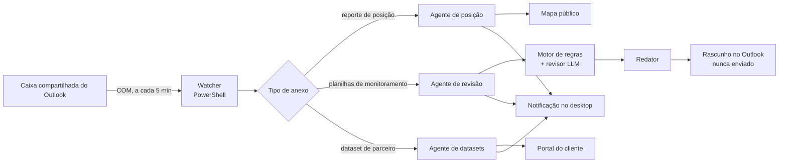

# Agentes de Revisão Acionados por E-mail (estudo de caso)

**Português** · [English](README.en.md)

Uma camada de automação de desktop que monitora uma caixa compartilhada do Outlook, salva os relatórios e planilhas que chegam e aciona três agentes: um publica posições de navios em um mapa público, outro revisa planilhas técnicas de monitoramento com um motor de regras determinístico mais uma "segunda opinião" de LLM, e o terceiro publica conjuntos de dados de parceiros em um portal do cliente. Um redator transforma os achados da revisão em um rascunho no Outlook; nada é enviado automaticamente.

Desenvolvido durante meu trabalho na Toveri, uma consultoria ambiental que monitora operações offshore. Apenas documentação: sem código-fonte, nomes de clientes, dados ou identificadores de infraestrutura.

> Este repositório contém apenas documentação. O código-fonte, os dados e a infraestrutura pertencem ao empregador e não estão publicados aqui. Veja [O que foi omitido intencionalmente](#o-que-foi-omitido-intencionalmente).

## Problema

Uma consultoria ambiental que monitora pesquisas sísmicas offshore recebe, a qualquer hora, e-mails de navios e parceiros: reportes diários de posição, planilhas de registros das equipes de monitoramento de fauna marinha e de monitoramento acústico passivo, logs de operação e de esforço, planilhas de controle de revisão e conjuntos de dados de parceiros.

Cada item precisa ser salvo, verificado e tratado. Revisar um registro de monitoramento é um trabalho minucioso: horários contra o log de operações, cálculos de interrupção para mitigação, estados da fonte e coerência entre o texto narrativo e os dados, à luz de instruções escritas e de precedentes definidos por revisores seniores. Feito manualmente, isso consumia as primeiras horas de cada dia em triagem antes de qualquer análise técnica.

Objetivo: material recebido salvo, verificado e resumido sem triagem manual, com toda mensagem de saída retida como rascunho até aprovação humana.

## Meu papel

Desenvolvedor único e principal usuário: reviso essas planilhas como parte da equipe ambiental, e projetei, construí e opero a automação. Usei desenvolvimento assistido por IA (Claude Code) durante todo o projeto; as decisões de design, a revisão e a responsabilidade pelos resultados são minhas.

## Arquitetura

### Watcher

- Um script PowerShell executado pelo Agendador de Tarefas do Windows a cada cinco minutos, oculto. Ele lê o Outlook via COM e nunca altera nem move e-mails.
- Deduplica pelo `EntryID` do Outlook (e por assunto mais horário de recebimento, no caso dos reportes de posição), mantendo um conjunto limitado aos últimos 3.000 itens vistos em um arquivo de estado; só processa e-mails recebidos depois que foi iniciado pela primeira vez.
- Uma execução por vez: uma execução ainda ativa após quatro minutos é considerada travada e encerrada; uma execução recente faz a nova sair.
- Se o Outlook estiver fechado (por exemplo, logo depois de ligar a máquina), ele abre o Outlook minimizado e sai; a próxima execução encontra a caixa sincronizada.
- Salva os anexos correspondentes em pastas por mensagem e aciona os agentes como processos ocultos separados, de modo que uma revisão que leva minutos nunca bloqueia o watcher.

### Executor de agentes

- Uma instância por tipo de agente, garantida por um arquivo de lock com limite de validade de 40 minutos.
- Se chegar material novo enquanto o agente de revisão está rodando, o executor registra um flag de "repetir ao terminar" em vez de iniciar uma segunda instância (até três passadas).
- O agente de posição esvazia uma fila de arquivos em ordem de nome, então os reportes são processados em ordem cronológica.
- Cada agente imprime um resultado em JSON (`status`, título, mensagem, link). O executor transforma isso em uma notificação do Windows com identidade de app própria registrada, com clique para abrir o resultado; desfechos silenciosos (sem mudança, ignorado) não geram notificação, e qualquer exceção gera uma notificação de erro.

### Agente de posição

O antecessor de desktop do pipeline na nuvem descrito no estudo de caso do mapa de operações marítimas: interpreta o reporte, aplica verificações determinísticas (mais recente que o publicado, bounding box regional, velocidade implícita), pede ao Claude uma opinião de plausibilidade e publica a última posição reportada como um arquivo no App Service do mapa, por meio da API VFS do Kudu. A autenticação usa um token de curta duração do Azure CLI já logado, então o agente não armazena nenhuma credencial no código nem em disco.

### Agente de revisão e revisor especialista

O agente de revisão encontra mensagens salvas nos últimos dois dias que contenham uma planilha de registros de monitoramento e uma planilha de controle de revisão, junta-as ao log de operações mais recente, calcula um hash das entradas (SHA-256 sobre nomes e bytes dos arquivos) para pular o que já foi revisado e executa o revisor especialista. Ele é somente leitura.

O revisor especialista tem duas camadas:

1. **Motor de regras (determinístico, cerca de 4.100 linhas de Python).** Lê as planilhas de registros (openpyxl; oletools para pastas de trabalho com macros) e as confere contra o log de operações e as instruções escritas: horários, cálculos de interrupção, estados da fonte, simultaneidade de eventos e se as correções pedidas em uma rodada de revisão anterior foram aplicadas.
2. **Revisor LLM.** Um dossiê por registro (dados do registro, achados das regras, linhas relevantes do log, trechos das instruções, precedentes aprovados) vai para o Claude com um system prompt que descreve o papel e o método de um biólogo marinho revisor experiente. O modelo precisa confirmar ou descartar cada achado das regras com uma justificativa e uma fonte, pode acrescentar observações técnicas ou biológicas e classifica cada item como **Erro** (divergência objetiva em relação ao log, à própria planilha ou a uma regra explícita), **Validação humana** (uma dúvida fundamentada, formulada como pergunta) ou **Sugestão** (apenas clareza, nunca enviada ao operador).

Detalhes de implementação:

- **Dois caminhos de acesso, um fallback.** Uma chave de API, se configurada; caso contrário, o Claude Code CLI logado localmente em modo headless (`-p`, sem ferramentas, schema JSON para a saída, executado a partir de um diretório temporário vazio, sem persistência de sessão). Sem nenhum dos dois, o revisor roda apenas com as regras e informa isso.
- **As regras sobrevivem à falha do modelo.** Qualquer exceção na camada de LLM é registrada, e os achados das regras continuam sendo reportados.
- **Normalização da saída.** O JSON do modelo é normalizado contra pequenas variações de nomenclatura, e um registro que o modelo marca como "approve" é elevado para "request revision" se contiver qualquer item de Erro.
- **Os originais nunca são abertos.** As entradas são copiadas para um diretório temporário antes da leitura.
- **Ciclo de feedback.** Quando um revisor sênior discorda de um achado, a discordância é armazenada em uma pasta compartilhada e os arquivos de critérios escritos são atualizados, para que a próxima execução aplique a prática corrigida.
- **Interfaces.** Um app web local (`ThreadingHTTPServer` do Python vinculado a `127.0.0.1`) com relatório em HTML e histórico, um ponto de entrada por linha de comando, uma skill do Claude Code e um instalador PyInstaller para colegas.

### Redator

Transforma um lote de relatórios de revisão na resposta que uma pessoa envia:

- pede ao modelo que verifique novamente cada ponto e só o mantenha se for sustentado pelos dados, não for redundante com algo que o revisor humano já escreveu, não for contradito por um precedente aprovado e não for especulativo ("na dúvida, descarte e explique por quê");
- escreve comentários e status em uma cópia da planilha de controle de revisão via Excel COM, mantendo o original intacto;
- cria um rascunho no Outlook com os anexos e um corpo curto, e salva as justificativas de cada item ao lado da planilha.

O item do Outlook é criado e salvo como rascunho. Não há chamada de envio no código; uma pessoa lê, edita e envia.

### Agente de datasets

Carrega as planilhas de monitoramento de um parceiro no portal do cliente por meio do próprio carregador do portal, após validação, e reporta um destes resultados: publicado, sem mudança, retido (a validação falhou, nada foi publicado) ou erro.

## Principais decisões de engenharia

- **Regras determinísticas primeiro, LLM como segunda opinião, aprovação humana no final.** As regras são rápidas, explicáveis e testáveis; o modelo acrescenta um julgamento que as regras não conseguem codificar e precisa justificar cada item com uma fonte. Toda mensagem de saída exige aprovação humana (human-in-the-loop).
- **Os agentes redigem, não enviam.** Isso elimina o modo de falha de maior impacto (uma mensagem errada para um cliente ou para o órgão regulador) por construção, e não por configuração.
- **Somente leitura por padrão.** O watcher nunca altera e-mails; o revisor trabalha sobre cópias; só o redator escreve, e apenas em uma cópia.
- **Idempotência em todo lugar.** Conjuntos de EntryID, hashes das entradas e verificações de "mais recente que o publicado" fazem com que uma reexecução ou um e-mail reentregue não gere trabalho nem publicação duplicados.
- **Nenhum segredo de nuvem armazenado nos agentes.** A publicação usa tokens do Azure CLI logado; o acesso ao LLM usa uma chave configurada localmente ou o CLI logado.
- **Processos pequenos e observáveis.** Cada agente é um processo separado com um resultado em JSON, uma linha de log e uma notificação, o que deixa as falhas visíveis no desktop em vez de enterradas em um log.

## Stack

- PowerShell 5.1, Agendador de Tarefas do Windows, automação COM do Outlook e do Excel, notificações toast do Windows
- Python (biblioteca padrão, openpyxl, oletools, pypdf)
- Claude via API da Anthropic ou via Claude Code CLI em modo headless
- Azure CLI (tokens de acesso), API VFS do Kudu
- PyInstaller (instalador do revisor)

## Testes e qualidade

- **Nenhum teste automatizado** para o watcher, os agentes, o revisor especialista ou o redator. Até aqui, a verificação é manual: execução sobre lotes reais e comparação com a revisão humana.
- Uma validação registrada (4 nov 2026): em um lote de registros de fauna marinha, a camada de LLM apontou os mesmos dois problemas que a revisão manual, nenhum dos quais o motor de regras detectou sozinho. Em um lote de acústica passiva, ela confirmou as correções pedidas na rodada anterior e levantou três perguntas para uma pessoa. É um único lote, não um benchmark.
- O motor de regras descende de dois revisores determinísticos independentes anteriores, que têm suítes pytest (36 e 80 testes). Esses testes não foram trazidos para o revisor combinado.

## Status

Em uso diário na minha estação de trabalho desde novembro de 2026 (o log do watcher começa em 9 nov 2026). O agente de posição agora roda em paralelo com o pipeline de ingestão na nuvem, que o substituiu; ambos são idempotentes. O redator é uma etapa separada, executada sobre os relatórios do revisor, e não encadeada automaticamente após cada revisão.

## O que foi omitido intencionalmente

- **Código-fonte, prompts e arquivos de critérios.** Propriedade do empregador; os critérios codificam a prática acordada com revisores seniores e as instruções escritas do cliente.
- **Nomes de caixas de e-mail, endereços de remetentes, nomes de clientes e parceiros, dados de navios.** Confidenciais.
- **Planilhas e relatórios de exemplo.** São registros regulatórios reais.

## Lições e próximos passos

- **Testes primeiro para o motor de regras combinado.** Portar as suítes pytest dos antecessores e adicionar testes golden-file construídos a partir de registros anonimizados, para que mudanças nas regras não causem regressões silenciosas.
- **Controle de versão.** Parte deste código ainda não tem repositório, e a cópia publicada do revisor está defasada em relação à local. Um único repositório com o watcher, os agentes e o revisor é o próximo passo.
- **Um único responsável por tarefa.** Aposentar o agente de posição de desktop agora que o pipeline na nuvem existe.
- **Menos dependência de uma estação de trabalho.** O watcher precisa de um desktop logado com o Outlook aberto. Um fluxo na nuvem acionado pela caixa de e-mail (como já foi feito para os reportes de posição) é o caminho para os outros agentes, onde as regras sobre os dados permitirem.
- **Medir antes de afirmar.** Manter um registro de concordância e discordância do revisor por lote, para que as afirmações sobre a utilidade da camada de LLM se apoiem em mais de uma rodada de validação.

Mais detalhes sobre decisões específicas: [docs/decisoes.md](docs/decisoes.md).
